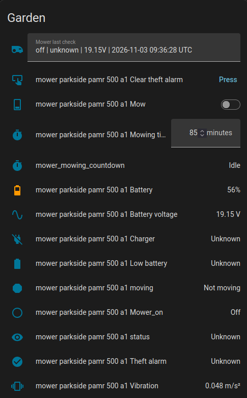
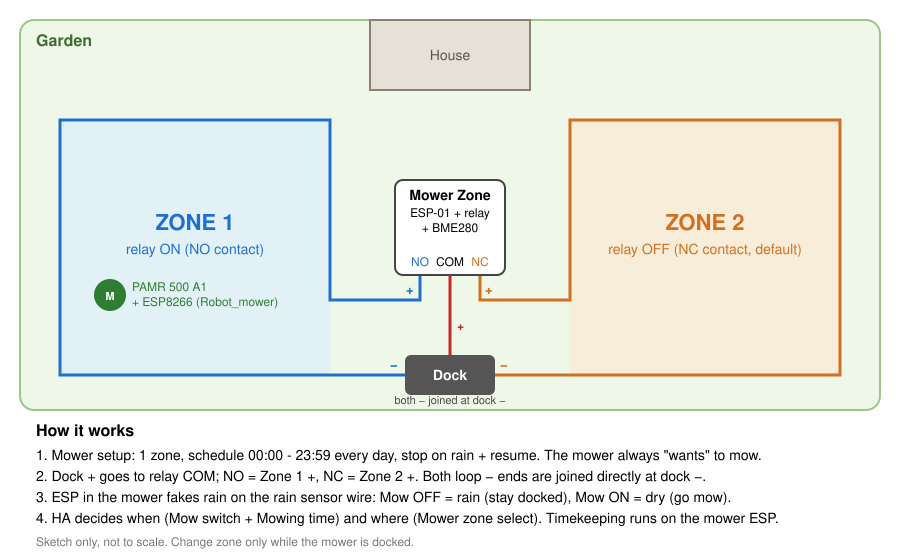

# Parkside_Mower_HA
Connect a non-smart robot lawn mower to Home Assistant, using ESPHome.

This setup runs on my **Parkside PAMR 500 A1**. It is based on [Gabriel-LG/HA_Mower](https://github.com/Gabriel-LG/HA_Mower) (made for the Parkside PMRA 20-Li A1) and extends it with battery protection, night quiet mode, theft detection, a 2-zone relay and Home Assistant automations.

From Home Assistant you can see the mower's status and battery, start it, set the mowing time and choose the zone.\

## Repository files
| File | What it is |
|---|---|
| `Robot_mower.yaml` | ESPHome config for the ESP8266 (Wemos D1 mini) inside the mower |
| `Mower_zone.yaml` | ESPHome config for the zone relay (ESP-01 + relay + BME280) next to the dock |
| `home_assistant/automations.yaml` | HA automations, exported from my HA |
| `home_assistant/helpers.yaml` | HA helpers used by the automations (timer, input_text, "Mower state" template sensor) |
| `docs/` | Pictures, circuit and the 2-zone sketch |

Secrets (`wifi_ssid`, `wifi_pass`/`wifi_password`, `mower_zone_api_key`) go in your ESPHome `secrets.yaml`. Change the fallback hotspot passwords (`xyz`).

## Concept: the mower decides nothing, HA decides when and where
The PAMR 500 A1 is configured as a plain mower:
- **1 zone**
- **schedule 00:00 - 23:59, every day**
- **stop on rain, resume when the rain is over**

So the mower always "wants" to mow. The ESP inside the mower is spliced into the rain sensor wire:
- `Mow` switch **OFF** = the ESP signals rain, the mower stays in (or returns to) the dock.
- `Mow` switch **ON** = dry, the mower leaves and mows.

Home Assistant decides **when** (turning `Mow` on, with a `Mowing time`) and **where** (the `Mower zone` select on the zone relay). Timekeeping while mowing runs on the mower ESP itself: when the mowing time is over it turns `Mow` off, so the mower always returns, even if WiFi is out of range or HA is down.

## 2 zones

The PAMR 500 A1 only knows one zone. A second boundary loop is added and the dock's wire output is switched between the two loops by a relay (`Mower_zone.yaml`):
- **Zone 1** = relay ON (NO contact)
- **Zone 2** = relay OFF (NC contact). This is the default at boot or after a power loss.

HA sets `select.mower_zone` before it starts the mower. Change the zone only while the mower is docked. The same ESP-01 carries a BME280 (temperature, humidity, pressure at the mowing area).

## What the mower ESP does (`Robot_mower.yaml`)
- **Status**: `Standby`, `Preparing`, `Mowing`, `Returning`, `Fault`, `Unknown`, worked out from the Mow switch, movement (MPU6050 vibration) and charging (battery voltage). `Fault` means: not mowing, not moving and not charging. It is a label from the ESP, not an error code from the mower.
- **Charging detection** from the battery voltage only (above 20.5 V, or rising). Extra rules: a docked mower holding its voltage for 5 minutes is treated as charging, and a 0.3 V drop from the peak while docked is treated as charger lost.
- **Battery** in V and % (5S Li-ion curve, 21.0 V = 100%).
- **Low battery** (~20%, 18.25 V for 30 s): stops mowing and blocks new starts until 20.0 V. **Critical** (~5%, 17.0 V): the ESP goes into deep sleep to protect the pack.
- **Quiet mode**: while docked, charging and healthy, WiFi is off. It comes on for the first 3 minutes of every hour (check-in), and whenever the mower moves or an alarm goes off.
- **Theft alarm**: while docked, a strong shake or a tilt change (~12 deg) sets `Theft alarm` and turns WiFi on. Clear it with the `Clear theft alarm` button.
- **Start request from HA** while WiFi is off: HA turns on `input_boolean.mower_start_pending`; the mower picks it up at the next check-in and starts, if the battery is not low and there is no theft alarm.

Because of quiet mode the mower shows as unavailable in HA most of the hour. That is normal.

> Note: the mower only charges after a run. Once full it does not top up in the dock, and the ESP slowly drains the pack (about 0.7 V/day). Regular mowing keeps it charged.

## Home Assistant side (`home_assistant/`)
Automations:
- **Mower - simple logic**: Mon / Wed / Fri at 11:11 and 15:11, sets the mowing time and turns `Mow` on.
- **Mower - start countdown on Mow ON** / **cancel countdown on Mow OFF**: run `timer.mower_mowing_countdown` for the dashboard.
- **Mower - last check**: stores the last check-in (`charger | status | voltage | time`) in `input_text.mower_last_check`, so the values survive while the mower is offline.

Helpers:
- `timer.mower_mowing_countdown`
- `input_text.mower_last_check`
- `sensor.mower_state` (template): `Working`, `Sleeping - charging OK`, `Idle - charging OK`, `Not charging`, `Warning` (no check-in for 2 h), `Issue` (no check-in for 10 h).

Entity ids in the files match my device names (`mower_parkside_pamr_500_a1_*`); adjust them if yours differ.

## Building the hardware
The hardware consists of an ESP8266 board, an accelerometer board, a DC/DC converter and 3 resistors, assembled together on a piece of perfboard.\
\

The hardware is mounted onto the battery pack and soldered directly to the battery poles (inside the battery housing).\
In the robot, one (single) wire needs to be spliced into a rain sensor wire. That is all the hardware needed in the mower.\

When the hardware is ready, build and upload `Robot_mower.yaml` to the ESP board (and `Mower_zone.yaml` to the zone relay). Configure the mower as described above (1 zone, 00:00 - 23:59 every day, stop on rain and resume). Make sure you have adequate WiFi coverage on your lawn, or at least at the dock.

If you have a different mower, some adjustments to the ESPHome configuration may be needed (battery voltage gain and thresholds in the `substitutions` block).

## Credits
Original project and hardware design: [Gabriel-LG/HA_Mower](https://github.com/Gabriel-LG/HA_Mower).
